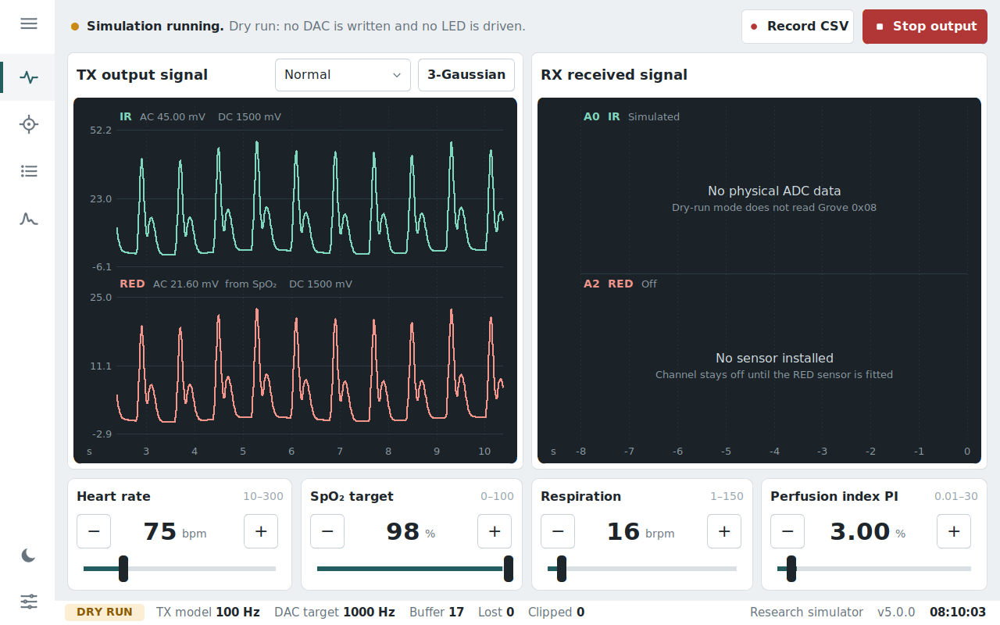
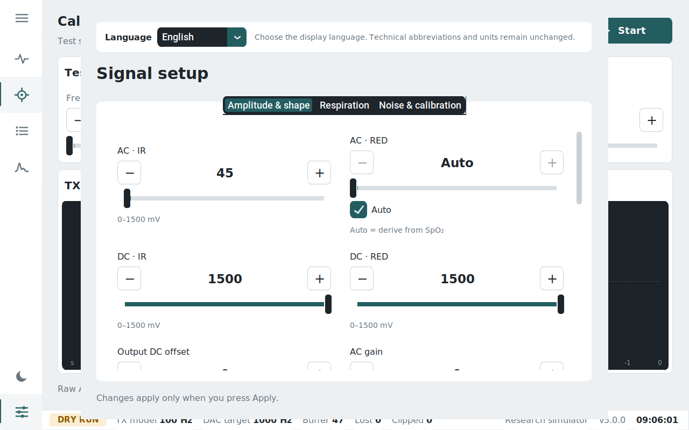
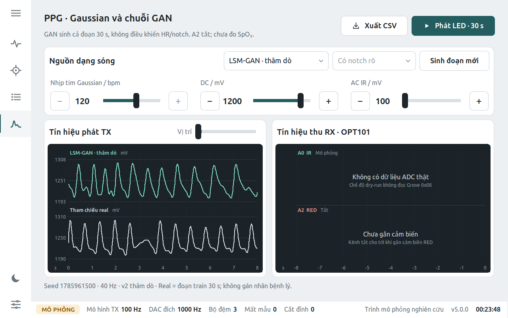
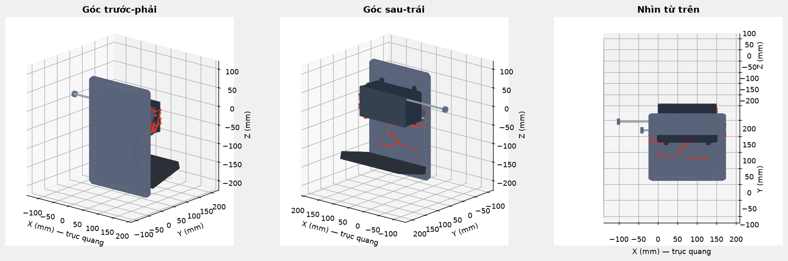
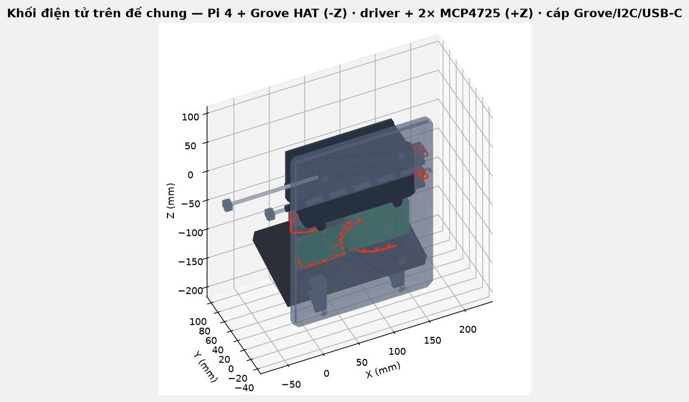
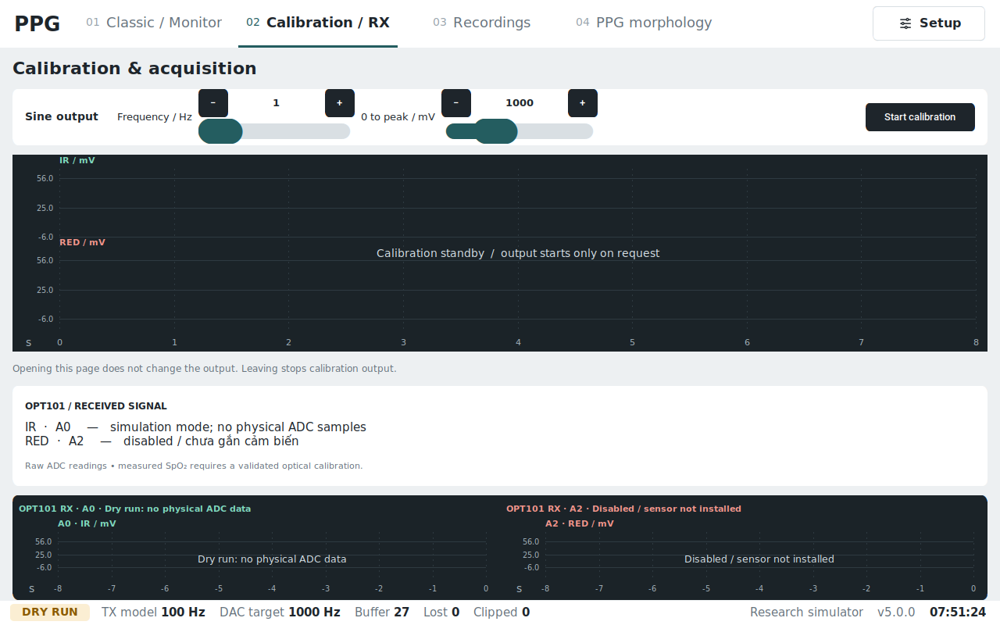
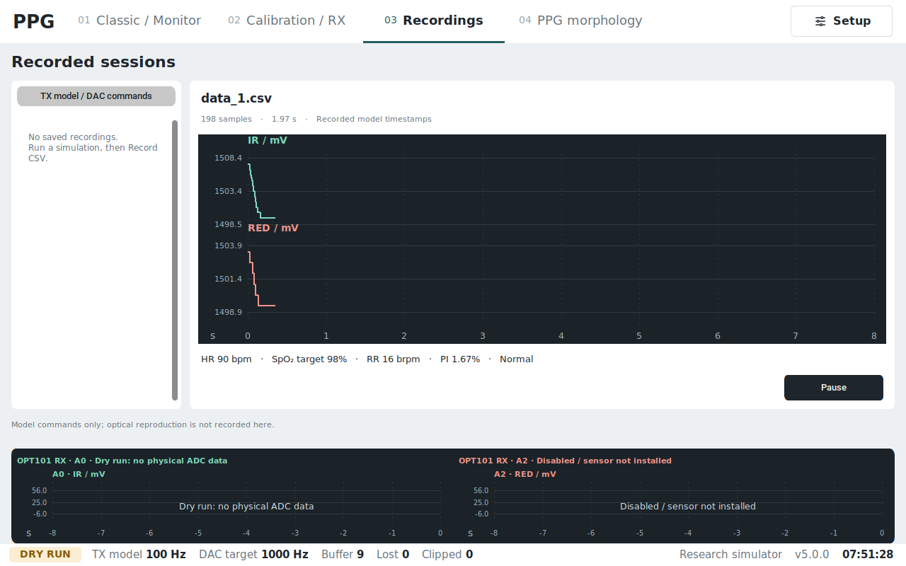

# 🫀 PPG Signal Simulator — Raspberry Pi 4

**Dual-channel PPG research simulator with Raspberry Pi software, three KiCad 10 boards and a printable optical enclosure.**


**Group #2:** HuyNN, VyPT
**Institution:** Industrial University of Ho Chi Minh City (IUH) — Faculty of Electronic Technology
**Version:** 5.0.0 — waveform controls and timestamped recording

---

## 📋 Overview

The Raspberry Pi runtime synthesizes IR/RED signals at 100 Hz, interpolates them
for a 200 Hz dual-MCP4725 output on ARM64 (500 Hz lost samples with the GUI and RX running),
and acquires OPT101 signals separately.
`PPG_DAC_RATE_HZ` supports 100/200/500/1000 Hz; desktop default is 1000 Hz.
Pi GUI + BLE + A0 verification at 500 Hz completed 30 seconds without buffer
overruns or dropped samples. Optical waveform fidelity is still unverified.
The empirical SpO₂ mapping is configurable; a realistic plot does not establish
optical accuracy or compatibility with a particular pulse oximeter.

**Touch and sequence update (30 September 2026):** Numeric controls use sliders;
Settings and calibration include −/+ fine steps. **04 PPG morphology** offers
fitted Gaussian and an exploratory **LSM-GAN 30-second sequence**, a real training
reference, and a live **OPT101 RX** card (A0/A4).
Play/Stop uses the shared MCP4725 writer; clips stop at 30 seconds or when leaving
the page. Opening the page does not emit output. Classic Gaussian is preserved.

LSM keeps native 40 Hz timing and has no HR/notch conditioning. The existing v2
checkpoint has excessive beat variability relative to median validation data;
it is a development baseline, not a validated human-PPG replacement. IR/RED share
one shape with nominal scaling. See [architecture choice, measured sequence audit
and touch/output details](docs/ppg_touch_sequence_output_2026-09-30.md).
The [earlier morphology comparison](docs/ppg_morphology_selection_2026-09-28.md)
remains a historical exploratory result; test has already been viewed.

**RX beside TX & Bench Diagnostics (October 2026):**
- **Live A0/A4 RX card on every page:** Classic, Calibration, Recordings and PPG morphology each show a read-only RX card next to the TX plot (the earlier bottom dock, and the RX strip inside the Signal setup window, are removed). It displays the rolling 8-second window at up to 10 Hz refresh, as the AC part only (DC removed; raw mV on the Calibration page), with explicit status states (disabled, dry-run, stale, error, full-scale) and touch-optimized scrolling on 1024×600 screens ([docs/rx-monitor-2026-10-01.md](docs/rx-monitor-2026-10-01.md)).
- **Physical Sensor Diagnostic Protocol:** A bench test and signal conditioning plan is established for OPT101 / CJMCU-101 modules, covering internal 1 MΩ feedback verification, 3.3 V Grove Hat input limits, dark readings, stepped sine wave tests (1–10 Hz), and RC low-pass filtering at $f_c \approx 33.9\text{ Hz}$ ([docs/opt101-a0-diagnostic-2026-10-01.md](docs/opt101-a0-diagnostic-2026-10-01.md)).

**RX analysis and APFT on the Pi (November 2026):** measured on the Pi 4 with the real DAC/OPT101 loop; details,
scripts and raw captures in [docs/hardware-validation/2026-11-14-ir-overload](docs/hardware-validation/2026-11-14-ir-overload/README.md).
- **Channel mapping and IR level:** IR = MCP4725 0x61 → ADC A4, RED = 0x60 → A0. The DAC code always reads back as
  written. Held above about 600–750 mV DAC, the IR receive level falls with on-time (1.9 → 0.8 V in 150 s at 1000 mV)
  and recovers after a rest; at ≤ 600 mV it holds within 2 % (§17). This sits after the DAC (IR LED/driver or optics),
  not in software.
- **RX SpO₂:** per-beat peak-to-trough ratio of ratios; the Calibration page's "SpO₂ calibration" sweeps 98/90/80/70 %
  and fits the receive path's A', B' (§13–14). One fit is kept per DC pair (up to 8, matched within 20 mV), so run the
  calibration at the DC levels you use; readings of 100–102 % are shown as 100 %. The Classic SpO₂ setpoint releases a
  manual RED AC so R follows it.
- **APFT-GAN on the Neural page** with an HR min–max range of 60–100 bpm (§18–20), see *Neural waveform models* below.
- **Pulse tone:** a short 880 Hz beep on every received beat, streamed through one `aplay` process so beeps do not
  click or drop (§15). Beat detection locks within about three beats after Start, including the dark → DC step.
  Heard on the Pi's HDMI monitor speaker.
- **RX respiratory rate:** spectral fusion of per-beat baseline, amplitude and interval (Charlton 2018) over 30–60 s,
  shown only when the peak is clear: read 10/18/27/36 brpm at 16 % modulation on the Pi, mostly "unclear" at the
  default 4 % (§16). An engineering check of the optical loop, not a clinical respiratory rate.

**Recordings, phone and remote (18 November 2026):**
- **Classic** shows HR, SpO₂, respiration and a **Noise** card (0–1 × AC); PI is no longer shown on any page.
- **Recordings** plays a saved CSV to the LEDs (it takes the DAC over from Classic) and deletes a recording (two taps).
  Files damaged by the old record-pump race (a few rows out of time order) are put back in order on load.
- **Database upload is opt-in:** a recording reaches PostgreSQL only when the user taps **Upload to DB** for that file
  (two taps, on the Pi or the phone); nothing is uploaded automatically.
- **PPG morphology:** *Save to Recordings* stores the current window as a Recordings CSV; *Export CSV* sends it
  (`time_s, ir_v, red_v`) to the phone, which saves it where the user picks.
- **MQTT** can use several brokers at once (the Pi's own Mosquitto over Tailscale and a cloud broker such as EMQX);
  `server/pi_broker/` installs and configures the broker on the Pi. The Android controller is
  [MedicalSimulator](https://github.com/halovie123/MedicalSimulator).

**MAX30102 mode (23 November 2026):** a MAX30102 cancels the steady simulator light as ambient light. With
**Settings → MAX30102** on, the red LED flickers between 0 and the PPG level 1500 times a second (preset DC 600 /
AC 300 mV, IR off), and a MAX30102 reads the pulse. HR, SpO₂ target, respiration and noise stay the user's;
Classic, PPG morphology (Model) and Recordings output all go out this way.
- Bench test with an ESP32-S3 + MAX30102 ([firmware/esp32s3_max30102](firmware/esp32s3_max30102/README.md)): 114 of
  115 one-second reports OK, darkness NO SIGNAL, 0 I2C errors
  ([docs/hardware-validation/2026-11-23-max30102](docs/hardware-validation/2026-11-23-max30102/README.md)).

  | Source | Set | MAX30102 read |
  |---|---|---|
  | Classic | 75 bpm | 72.6–73.9 bpm |
  | Classic | 110 bpm | 106.6–109.1 bpm |
  | Model (Gaussian clip) | 80 bpm | 79.2–80.1 bpm |
  | Recordings (`data_1.csv`) | 79 bpm | 76.4–78.9 bpm |

- No SpO₂ in this mode: both sensor channels see the same red light. The OPT101 RX pauses while the mode runs.

| Live monitor | Waveform setup | 30-second sequence |
|---|---|---|
|  |  |  |

### What's complete in v5

- Light controls, charcoal IR/RED plots, large setpoints and timestamp axes. The UI scales automatically from compact 7-inch 1024×600 panels through Full-HD/QHD desktop displays.
- HR 10–300 bpm; respiration 1–150 brpm; SpO₂ target 0–100%; noise level 0–1 × AC. PI is no longer shown in the UI.
- Independent IR/RED AC and DC, AC/DC ownership, output offset, gain and polarity.
- PPG, sine, triangle and square waveforms; independent SP/DN/DP timing for each channel.
- Baseline, amplitude and frequency respiratory modulation, inhale/exhale ratio, per-channel variation and periodic apnea.
- Absolute-mV artefacts with optional seeds; configurable HR/amplitude, SpO₂/notch and beat-variability effects.
- Timestamped 100 Hz model-command CSV recording continues across pages; playback follows the recorded timestamps.
- Explicit Start/Stop for calibration; only the engine's DAC thread produces its sine output.
- Configuration round-trip, validation and atomic JSON save. Opening a page does not change signal parameters.
- English/Vietnamese UI; touch-sized controls; TX on the left and live OPT101 A0/A4 RX on the right of every page.
- Collapsible left navigation rail (icons collapsed, labels overlay when expanded), light/dark theme saved in `config.json`, and a Classic page with TX and RX side by side. The status line reports *no MCP4725 at 0x60/0x61* instead of claiming LED output when the DACs do not answer.
- `scripts/deploy_and_run.sh` (run on the laptop): SSH check, `i2cdetect -y 1` report for 0x08/0x60/0x61, rsync to the Pi, restart the app on the Pi display (the autostart user service when it is installed), and a dry-run copy on the laptop. When the Ethernet link reports `NO-CARRIER`, use the Wi‑Fi address: `PI_HOST=user@<pi-wifi-ip> scripts/deploy_and_run.sh`, and stop any other running instance first so two apps do not share I2C/BLE.

See [the continuation and validation report](docs/phase_reports/V5_CONTINUATION_REPORT.md)
for scope, evidence, commercial-reference comparison and physical validation still needed.

### Neural waveform models

The app's Neural page offers the fitted three-Gaussian shaper and three 30 s, 40 Hz sequence generators: LSM-GAN
(BIDMC, no rate control; `assets/neural/`), PSF-GAN (requested HR; `assets/psf/`) and APFT-GAN v3 HR v1 (checkpoint
1250, 100.5 M parameters, `assets/apft/`, weights in Git LFS). APFT takes an HR min–max range inside 60–100 bpm: the
worker measures each generated window's beat rate and keeps only one inside the range (`core/apft_range.py`). None has paired
IR/RED or calibrated SpO₂; SpO₂ and respiration are not model inputs. Each window is made in a separate worker process
with one BLAS thread. APFT runs in float32 with the same weights as released; `core/apft_fast.py` skips the random
initialisation on load and computes the flow head's time-only terms once per patch, which gives bit-identical windows.
Measured on the Pi 4 with the GUI running: load 10.2 → 6.6 s, one window 94.8 → 45.7 s at ~100 % of one core, a batch of 8
windows 57 s; an HR-range request usually finishes in one or two batches (about 1–2.5 min), and the page allows 300 s.
Dynamic int8 was faster (21.7 s) but changed the generated waveforms, so it is not used. Measurements:
[§18–20](docs/hardware-validation/2026-11-14-ir-overload/README.md).

PhysioMix (round 9) and PhysioFlow (round 10) were removed from the app with every research generator that did not
improve on them. A strict real-vs-generated judge retrained per source on unseen people (C2ST, validation AUC; 0.5 =
indistinguishable, the real-vs-real control is about 0.45) still separated them at 0.99–1.00, as it did PhysioMix with
the strict critic, LSM-GAN-S, the flow-GANs G1–G3, BeatGen and the spectral-finish variants (0.95–1.00). Kept for
further work: PhysioFlow-R (R1, mean 0.759 over seeds 0.745–0.785 at 16 Heun steps, the only clear gain), its fine-tune R1F and PhysioGAN-R
(P5, in training), and the LSM-GAN author topology as the unchanged baseline. The removed models' results stay in
`ml/runs`, [docs/model-report](docs/model-report/README.md) and [docs/physioflow/REPORT_VI.md](docs/physioflow/REPORT_VI.md);
their code is in git history. These are engineering evaluations of normalized waveform shape, not clinical
validation, and they were not measured on the Pi/DAC/OPT101.

PPG-physiGPT (`ml/kaggle_physigpt/`) is an unconditional GPT-PPG-style patch
transformer with a flow-matching head, pretrained on MIMIC-III WDB on Kaggle 2 x T4. The strict judge still separates
every variant (AUC 1.0). On a second, feature-level tier (1 - KS over 14 waveform features against unseen people),
the 99.9M large model reaches 0.941 against 0.933 for the best 30.7M base, where real people score 0.960. It is the
V1 release: V1 asks for 95% of the real-vs-real similarity (large: 98.1%). The V2 target, absolute 0.95 with a
feature-only tree classifier at most 0.60 accurate (large: 0.618), is not met; the gap left is 5-8 Hz detail. Results and run records: [docs/physigpt](docs/physigpt/README.md).
Its heart-rate-conditioned adversarial fine-tune, APFT-GAN v3 HR v1 (checkpoint 1250, verdict still "fail" with strict judge
AUC 1.0), is the APFT-GAN mode of the Neural page described above.

#### Earlier models (history)

The **04 PPG morphology** page keeps the original three-Gaussian
generator and offers the LSM-GAN sequence as an experimental model. The
cWGAN-GP checkpoint below is retained for research comparison; it is not the
current sequence source. Both neural models were trained from BIDMC 1.0.0 PPG
records using subject-separated train/validation/test groups. They do not learn
separate IR and RED optical channels.

| Model | What goes in → what comes out | Network idea | Current role |
|---|---|---|---|
| cWGAN-GP pilot | 32-value random latent vector + 7 measured morphology conditions → one 256-point, phase-normalized pulse | Dense layers followed by three linear-upsample/Conv1D stages; strided-convolution critic; Wasserstein loss with gradient penalty | Research artifact only; the pilot export contains G but not its trained critic. The app's older preview repeated this one pulse to form a longer trace. |
| LSM-GAN v2 | A random 1,200-point noise strip → 1,200 PPG samples, 30 s at 40 Hz | Generator has parallel Conv1D branches (kernels 5/21/61) and a spectral-matching objective; its discriminator is a CNN with two real/fake scores | Experimental long-sequence option in page 04; no HR/notch control. |

For LSM-GAN, training used 624 non-overlapping 30-second windows from 32
patients; validation and test each used 112 windows from 7 separate patients.
BIDMC's 125 Hz signals were resampled to 40 Hz, filtered at 0.9–5 Hz and
normalized per window. This is not raw, full-band PPG or a healthy-population
dataset. The model produces a normalized shape; the app maps that shape to
nominal IR/RED voltage levels, so it does not predict two independently learned
optical signals or calibrated SpO₂.

These experiments are **exploratory** because the test set had already been
viewed. cWGAN makes a single pulse while LSM-GAN makes a long sequence, so
their scores are not a fully like-for-like ranking. Selection considers the
pre-agreed spectrum similarity, autocorrelation and high-frequency energy;
loss and discriminator scores alone are not evidence of realistic PPG.
See the [detailed LSM/GAN report](docs/ppg_lsm_gan_report_2026-09-26.md),
[cWGAN and LSM integration audit](docs/ppg_neural_preview_report_2026-09-28.md)
and [current sequence and hardware validation](docs/ppg_touch_sequence_output_2026-09-30.md).

### Key Specifications

| Parameter               | Value                                           |
|------------------------|-------------------------------------------------|
| Platform               | Raspberry Pi 4 (Ubuntu 24.04/26.04 LTS, arm64)  |
| UI Library             | CustomTkinter                                   |
| DAC                    | MCP4725 (12-bit, I2C) × 2 — IR & Red channels   |
| Model Rate             | 100 Hz                                          |
| DAC Rate               | Pi: 500 Hz target; configurable; Linux/I²C timing requires measurement |
| Data Recording         | 100 Hz model commands, timestamped CSV in `dataset/` |
| DAC Voltage Range      | Configured 0–3.28 V (0 → 0, 3.28 V → 4095) |
| Live RX ADC Channels   | A4 (IR) & A0 (Red) on Grove Base Hat (I2C 0x08) |

---

## 🛠️ Hardware Architecture

### Pin Mapping (Raspberry Pi 4, BCM numbering)

```
MCP4725 DACs (I2C Bus 1):
  GPIO2 (pin 3)   → I2C1_SDA
  GPIO3 (pin 5)   → I2C1_SCL
  Addresses: 0x61 (IR channel), 0x60 (Red channel)

Display:
  HDMI → Any screen (auto-detect resolution)
```

### Official KiCad PCB design

The official panel contains **two electrically independent boards**: the
70 × 20 mm OPT101 receiver and the 70 × 40 mm LED/IR driver. The 70 × 60 mm
panel has one V-score at 20 mm from the top. BPW34 remains available as a
separate historical alternative and is not part of this panel.

- [Two-board panel and build instructions](hardware/ppg_panel/README.md)
- [LED/IR driver schematic, PCB and wiring](hardware/led_ir_driver/README.md)
- [OPT101 receiver](hardware/opt101_receiver_kicad/opt101_receiver/README.md)
- [BPW34 receiver (alternative)](hardware/bpw34_receiver/README.md)

The driver uses a single shared I²C connection: J2 pins 3–6 are SCL, SDA,
3.3 V and GND. Both MCP4725 modules share that bus; configure different
addresses (IR 0x60 and RED 0x61). J2 pins 1–2 are the IR DAC output and GND,
not part of the four-wire I²C cable. J2 uses a 2.54 mm 1×2 header and a
separate 2.00 mm 1×4 header. There are no J8/J9 I²C headers or R11–R14 /
JP1–JP4 I²C options on this design. See the driver README before wiring.

This restores the earlier shared-bus driver; later v2.0 manufacturing-rule
changes are not incorporated. Existing three-board panel and v2.0 driver
fabrication files are obsolete and have been removed. Recheck board-house
requirements and regenerate Gerber/drill files before ordering. CAD checks do
not establish physical operation.

### Printable optical enclosure

The dark chamber has separate RED/IR lanes, a sliding LED carrier, replaceable
apertures, a labyrinth lid and cable passages. The parametric model and assembly
instructions are in [docs/system_3d](docs/system_3d/README.md). For a 180 mm
Bambu bed, use the [three-plate print package](docs/system_3d/out/print_bambu_180.zip)
for the original enclosure parts. The compact receiver PCBs use **separate H-shaped
supports**, with open space under the PCB for header cables: [OPT101 STL](docs/system_3d/out/print_bambu_180/14_ga_chu_U_OPT101_70x20.stl)
and [BPW34 STL](docs/system_3d/out/print_bambu_180/15_ga_chu_U_BPW34_70x20.stl).
The driver has its [70 × 40 mm adapter STL](docs/system_3d/out/print_bambu_180/16_ga_driver_70x40.stl).
Read the [mounting notes](docs/system_3d/out/print_bambu_180/README_PCB_MOUNTS.md)
before printing: the receiver support is 3.8 mm thick in a 4.3 mm nominal slot;
test-print one support and check fit in the actual enclosure.




KiCad ERC/DRC, schematic-to-PCB checks and nominal mechanical collision checks
are recorded in each hardware project's `reports/` and `mechanical/` folders.
They do not establish physical fit, analog noise, optical isolation or LED current.
Check module pin order, MCP4725 I²C addresses, supply voltage and fit on the
actual parts before powering the assembly.

> **The IR lane has no STLs of its own — this is deliberate, not a missing
> export.** The two optical lanes are mirror-symmetric about z = 0, so the
> `slide_shaft`, `led_carrier`, `push_rod`, `rod_knob`, `aperture_*` and `hood_*` parts are
> exported once under the `_red` name and printed twice (the `*_ir` copies exist
> in `model.json` for the viewer only). Print counts are in the STL table of the
> `docs/system_3d/` README.

---

## 💻 Software Architecture

### Folder Structure

```
PPG_simulator_raspi/
├── main.py                      # Application entry point
├── config.py                    # Constants, theme & styles (single source of truth for version)
├── config_store.py              # JSON configuration persistence & validation
├── core/
│   ├── signal_engine.py         # Signal generation thread & DAC output
│   ├── ac_balance.py            # AC balance: DAC AC scaled so the received AC equals the set AC
│   ├── csv_logger.py            # Dataset recording logic
│   ├── tx_rx_logger.py          # Paired TX command & RX acquisition logger
│   └── rate_scheduler.py        # Drift-free fixed-rate execution ticker
├── hw/
│   ├── opt101_rx.py             # Grove Base Hat ADC reader (A0/A4 channels)
│   ├── dac_manager.py           # Dual MCP4725 I2C DAC controllers
│   └── max30102_flicker.py      # MAX30102 mode: paced red-LED on/off writer (its own process)
├── models/
│   ├── ppg_model.py             # PPG physiological synthesis model
│   ├── noise.py                 # Artefact generators (absolute-mV, band-limited)
│   ├── respiration.py           # Respiratory baseline/amplitude/RSA modulation
│   ├── waveform.py              # Pulse morphology (Gaussian, sine, square, triangle)
│   └── limits.py                # Parameter limits and boundary validation
├── led_driver/                  # Op-amp + BJT current-sink calculations & error budget
├── ui/
│   ├── ctk_app.py               # Main CustomTkinter UI shell & window manager
│   ├── rx_monitor.py            # Read-only A0/A4 RX lanes shown beside TX on every page
│   ├── trace_view.py            # High-performance trace plot widget
│   ├── touch_slider.py          # Touch-optimized slider with +/- step buttons
│   ├── advanced_controls.py     # Parameter validation & event dispatcher
│   ├── i18n.py                  # English and Vietnamese UI translations
│   ├── responsive.py            # Multi-resolution UI scaling (1024x600 to 4K)
│   └── frames/
│       ├── pathology_frame.py   # Classic PPG simulator & pathology controls
│       ├── calibration_frame.py # Sine wave DAC test & calibration
│       ├── advanced_frame.py    # Signal setup (AC/DC ownership, SpO2, artefacts)
│       ├── neural_frame.py      # LSM-GAN 30s sequence & morphology evaluation
│       └── playback_frame.py    # CSV recording browser & playback viewer
├── firmware/esp32s3_max30102/   # ESP32-S3 + MAX30102 + ST7789 test receiver (ESP-IDF, PlatformIO)
├── hardware/                    # KiCad 10 projects, V-cut panel & release ZIPs
├── docs/                        # Design documents, reports, and 3D STL models
│   ├── opt101-a0-diagnostic-2026-10-01.md # Bench test plan for physical sensor
│   ├── rx-monitor-2026-10-01.md           # Live RX view design notes & validation (dock era)
│   ├── ppg_touch_sequence_output_2026-09-30.md # Touch controls & GAN details
│   └── system_3d/               # 3D printable dark enclosure STLs & guide
└── dataset/                     # Recorded CSV dataset files
```

---

## 🔧 Installation & Setup

### 1. Prerequisites
- Raspberry Pi 4 with Ubuntu 24.04 or 26.04 LTS (aarch64)
- I2C enabled (`dtparam=i2c_arm=on` in `/boot/firmware/config.txt`; the setup
  script can add it after confirmation)
- Python 3.10+ and OS package `python3-tk`; install dependencies inside a venv.

For Ubuntu, use the repository setup script instead of installing into the
system Python:

```bash
./scripts/setup_rpi_ubuntu.sh --enable-i2c
```

For a laptop-to-Pi Ethernet cable, source transfer, repeatable `ping`/`ssh`
commands, and remote debugging, follow
[docs/setup/RASPBERRY_PI_4_UBUNTU_26_04_SSH.md](docs/setup/RASPBERRY_PI_4_UBUNTU_26_04_SSH.md).

### 2. Laptop setup, run and tests

```bash
python3 -m venv .venv
.venv/bin/python -m pip install --upgrade -r requirements/test.txt
.venv/bin/python main.py --dry-run
PPG_DRY_RUN=1 .venv/bin/python -m pytest -q
```

On the configured Raspberry Pi, use `.venv/bin/python main.py` for hardware mode.
Virtual environments are deliberately excluded from Git; recreate one on each
machine because wheels and interpreter paths are architecture-specific.

GUI interaction and screenshot check (requires a real display or Xvfb):

```bash
.venv/bin/python scripts/smoke_ui.py --output docs/ui
```

Install the PPG Simulator icon in the Raspberry Pi application dashboard and
place a trusted shortcut on the desktop:

```bash
./scripts/install_desktop_launcher.sh
```

The launcher uses this checkout's `.venv`, starts the normal GUI with BLE
and writes startup logs to `~/.local/state/ppg-simulator/launcher.log`.
`main.py` itself allows one instance per user, however it was started: a
second copy, including `--dry-run` and `--ble-only`, exits with status 75 and
names the process that holds `~/.local/state/ppg-simulator/app.lock`.

For a standalone bench, install the systemd user service. It starts the
simulator with the Pi's desktop session and restarts it after a crash; once it
is installed, the icon starts that service. Automatic login, the restart limits
and the commands are in
[setup guide §11](docs/setup/RASPBERRY_PI_4_UBUNTU_24_04.md#11-start-automatically-with-the-desktop-session):

```bash
./scripts/install_user_service.sh --now
```

The laptop environment verifier also audits Git hygiene and rejects committed
virtual environments, bytecode and generated package caches.

### 3. BLE remote control (Android app)

The simulator can be driven from the Android app (`com.medical.simulator`)
over BLE GATT: `pip install -r requirements/ble.txt`, then run with `--ble`
(GUI) or `--ble-only` (headless). The phone advertises-pairs as central, sends
JSON setpoint commands (HR/SpO₂/RR/noise/condition plus AC/DC amplitude
0–1500 mV per channel) and receives the 50 Hz waveform plus a 5 Hz status
snapshot with bidirectional sync. Protocol v3 adds the other pages: the phone
switches the Pi's page and drives Calibration, Recordings and PPG morphology
(models still run on the Pi), and receives the TX/RX plots and each page's state.
Full contract: `docs/ble_protocol.md`.

```bash
PPG_DRY_RUN=1 .venv/bin/python main.py --dry-run --ble        # GUI + BLE
PPG_DRY_RUN=1 .venv/bin/python main.py --dry-run --ble-only   # headless
```

### 4. Remote control over the internet and recordings in a database (trial)

The same commands and page state also travel over an MQTT broker (TLS), so the
app can control the Pi from anywhere (one or more brokers, tried in order; the
Pi's own broker is set up with `server/pi_broker/`). A recording in `dataset/`
is copied to PostgreSQL through a small HTTP API only when the user taps
**Upload to DB** for it; the CSV on the Pi stays the primary copy. The trial
API on the local network uses plain HTTP, so its token is not encrypted. Both start only when
`~/.config/ppg-simulator/remote.json` configures them (`pip install -r
requirements/remote.txt`; `--no-remote` turns them off). A trial broker,
database and API run from `server/` (`server/scripts/setup_trial.sh`).
Details, security notes and what was tested: `docs/remote_mqtt.md`.

---

## Operation

**Monitor:** adjust HR, SpO₂ target, respiration and noise with sliders, or type a
value and press Enter. Run starts TX; Stop parks both DAC command values at zero.
Record CSV starts capture; Save recording closes the file into `dataset/data_N.csv`.
Closing the app saves an active recording. The plotted signal is generated TX,
not an optical measurement. The right-hand numbers are setpoints.

**Signal setup:** each tab applies only when its Apply button is pressed.
Blank RED AC derives it from SpO₂. Explicit RED AC disconnects that amplitude
from the SpO₂ target and the monitor reports this. Lock AC holds AC while a PI
change moves IR DC; Lock DC lets PI move AC; both locks make PI read-only.
Feature times are quoted at 60 bpm and scale with cycle duration.

For a repeatable nominal waveform, disable respiratory modulation and all three
physiological dynamics switches on the Respiration tab. Otherwise modulation,
HR coupling and beat variability deliberately change the instantaneous AC/HR.

**Calibration & Sine Generator:** enter sine frequency (1–10 Hz) and peak output (100–3280 mV),
then Start calibration. Opening the page alone does not start output. Leaving the
page stops an active calibration. Sine calibration drives both MCP4725 DAC channels simultaneously.

**Optical operating levels (after moving an LED carrier or the receiver):** each
LED→OPT101 path has its own gain, turn-on and ceiling. On 2026-11-14 the IR
driver stopped adding current above ~0.6–0.75 V DAC (~3 mA) and the OPT101
outputs topped out at ~2.5 V (datasheet minimum at 3.3 V: 2.0 V). Drive past
the IR knee made the IR reading fall for seconds; that, not the ADC or the UI,
clipped the old Calib sine. See docs/hardware-validation/2026-11-14-ir-overload.

**Calibration pass dots.** Set IR/RED levels (DAC mV), an optional ± sine and a
± tolerance, then Start. The dot beside each RX lane blinks green while the
OPT101 lane reads the sent level (or the sine peak/trough) within the
tolerance; the text shows the received value and Δ = received − sent. There is
no automatic optical compensation: a dot that stays red means that path's
optical gain or range differs, to be fixed in the optics or the levels.

**Live RX card:** every page shows an RX card to the right of its TX plot
(the Signal setup window has none). The receiver samples the Grove Base Hat ADC at 100 Hz and refreshes the UI at up to 10 Hz,
plotting an 8-second rolling window for A4 (IR) and A0 (Red). Each lane plots the AC part only: the mean of
the lane over the window (its DC level) is subtracted, the axis is centred on 0 mV and the header gives the
peak-to-peak swing (`AC 60 mV p-p`) instead of the received level. The Calibration page is the exception: it
plots the received millivolts, because there the received level is checked against the sent one. Only the plot
changes; the RX rate, SpO₂ and respiratory-rate estimates, the TX/RX log and the stream to the phone keep the raw
samples. Each lane also shows its connection status (`LIVE`, `STALE`, `DRY RUN`, `DISABLED`, or `FULL SCALE`).

**AC balance (Classic):** each LED -> OPT101 path has its own small-signal gain, and the IR one grows with the DC
level (DC sweep of 2026-11-21 at 45 mV AC: received/sent AC 1.28-2.08 on IR, 1.12-1.25 on RED). With
**AC balance: on** (button on the RX card, saved in `config.json` as `ac_balance_enabled`, default on) the AC
written to each DAC is scaled so the AC the OPT101 receives equals the AC set on the page (`core/ac_balance.py`):
a feedforward factor 1/g(DC) from the measured gain table (`ac_gain_table` in `config.json` replaces the
built-in one), then a closed-loop trim that compares the per-beat AC of TX and RX every 10 s and moves at most
15 % per update within 0.6-1.6. The loop skips windows with OPT101 saturation, RX gaps, too few beats or an
unsteady pulse, and holds during the receive SpO₂ calibration. The TX plot keeps the set waveform; its header
gives the factor (`DAC AC ×0.53`). Only the Classic AC is scaled: DC, Calibration test signals and played clips
are not. Receive SpO₂ fits record whether AC balance was on and apply only in that state. This balances the AC at
this simulator's own receiver; it is not a calibration of another receiver.
Dry-run mode and unplugged sensors explicitly show disconnected states without fabricating data.

**MAX30102 mode (Settings → MAX30102):** tick *MAX30102 mode* and press *Apply MAX30102 mode*; the choice is saved
in `config.json` (`max30102_mode`).

- **What the mode does:**
  - DC/AC of both channels are set to the preset DC 600 / AC 300 mV and held there; the amplitude tab cannot move
    them while the mode is on.
  - Only the red LED is driven, as an on/off flicker at 1500 writes/s whose on-level follows the PPG, capped at
    1000 mV. IR stays at 0 V.
  - Heart rate, SpO₂ target, respiration and noise remain yours, on the page or from the phone.
  - Switching the mode off puts your own DC/AC back. A saved configuration keeps your values, not the preset.
- **Model and Recordings in this mode:** clips are rescaled so their pulse spans DC 600 → 900 mV; the shape, beat
  timing and respiration of the clip are kept. The DC/AC sliders of the PPG morphology page do not apply, and both
  pages say so in their status line.
- **Rates:** the writes come from a separate paced process (`hw/max30102_flicker.py`). The rate is chosen to stay
  away from multiples of the sensor's sample rate: 2000 writes/s at 200 sps read 144 bpm for 75 bpm.
- **OPT101:** acquisition is paused while the output runs, because its I2C reads disturbed the write timing. AC
  balance does not apply in this mode.
- **Not covered:** the mode gives a heart rate to a MAX30102, not SpO₂ or a calibrated waveform. A Calibration-page
  test signal is never flickered.

**Neural Sequence & Morphology Evaluation:** the **04 PPG morphology** page allows selecting
between the standard three-Gaussian pulse synthesis and an experimental 30-second LSM-GAN
continuous pulse sequence. Clips automatically stop at 30 seconds or upon navigating away.
Opening the screen does not activate DAC output without an explicit Play action.
The TX card stacks the generated lane over the real reference lane; the RX card
on the right shows A0/A4 from the receiver.

**Recordings:** review saved TX command CSVs. Play sends the recorded DAC codes to
the LEDs in place of Classic; the trash button deletes a file and Upload to DB
sends one file to the database (each asks for a second tap). The session
list is a drawer that folds to one icon and closes after a recording is picked.
Recorded TX sits on the left and the live RX card on the right; that RX is the ADC
reading at viewing time, not data stored in the recording. New files
contain `Time_s` and `Source`; the first seven columns retain the legacy schema.
Legacy files without timestamps explicitly assume 50 Hz for screen playback.
CSV output is a model command record, not proof that a DAC wrote every sample.

**Bench Diagnostics & Optical Validation:** for physical sensor testing with the OPT101 / CJMCU-101 module,
follow the testing protocol in [docs/opt101-a0-diagnostic-2026-10-01.md](docs/opt101-a0-diagnostic-2026-10-01.md):
1. Verify module pinout (ensure 1 MΩ internal feedback loop between pins 4 & 5; do not leave floating).
2. Measure baseline dark voltage under complete optical enclosure sealing.
3. Perform stepped sine excitation (1, 2, 5, 10 Hz) via DAC to measure sensor linearity, phase shift, and harmonic distortion.
4. If high-frequency ripple or ADC noise is present, insert an anti-aliasing RC filter ($R = 4.7\text{ k}\Omega$, $C = 1\ \mu\text{F}$, $f_c \approx 33.9\text{ Hz}$) between the OPT101 OUT pin and Grove A0 input. Keep Grove signals strictly $\le 3.3\text{ V}$.

| Calibration and RX status | Recording review |
|---|---|
|  |  |

## Signal relationships and limits

`PI = AC_IR / DC_IR × 100`; at DC=1500 mV, PI=3% gives nominal AC=45 mV.
RED is derived with the full ratio-of-ratios:

`R = max(0, (A − SpO₂_target) / B)`

`AC_RED = R × AC_IR × DC_RED / DC_IR`

The defaults A=110 and B=25 are an empirical example, not universal optical
calibration. The former R clamp of 0.4–1.6 has been removed so low SpO₂ targets
change the generated ratio. A negative requested R cannot be synthesized; the
monitor reports it. Unequal respiration depth and manually pinned RED AC can
change the instantaneous ratio from the nominal target.

PPG uses a normalized three-Gaussian shape. Respiratory depth defaults to 4% of
AC per channel, with baseline/amplitude/RSA modulation individually selectable.
Apnea suppresses respiratory modulation while cardiac pulses continue.

Direct AC entry spans 0–1500 mV and DC entry 0–1500 mV, matching the Android
app. PI-driven AC stays inside the direct AC range at these limits; output
offset spans 0–2000 mV with DC+offset≤3000 mV. Gain,
noise and modulation can still exceed DAC headroom: the output clamps to the
configured rails and the clipping counter reports it. A clipped waveform does
not meet the requested amplitude or ratio.

50/60 Hz mains noise is rejected by the 100 Hz synthesis model; 10× interpolation
does not create additional bandwidth. Likewise, the MCP4725 code step is about
0.80 mV at 3.28 V: software entry resolution is finer than physical DAC resolution.

The LED-driver topology in the supplied drawing is DAC → op-amp → NPN current
sink with emitter feedback through R_sense. The 3D preview defaults to this direct
command path, and offers the older 10k/10k divider hypothesis separately. Its
`I ≈ Vcmd/R` readout is an ideal estimate; current, compliance and optical response
must be measured on the actual assembly. No wiring, transistor or resistor is
changed by this software update.

## References

The datasheets, papers and web sources used by the hardware, PPG model and
neural-model work are collected in [docs/REFERENCES.md](docs/REFERENCES.md).

## 👨‍💻 Authors

**HuyNN** — Hardware design, embedded firmware  
**VyPT** — Software design, UI/UX

**Institution:** Industrial University of Ho Chi Minh City (IUH)

## Official PSF model (2026-11-12)

PSF J3 EMA step 5500 is the official project baseline. The CPU TorchScript bundle, checksum, runtime contract and comparison with J4/J5/J6 are documented in [assets/psf/README.md](assets/psf/README.md). This remains an experimental simulator: held-out similarity 94.94%, tree accuracy 66.625%; the global realism gate has not passed and clinical validation is absent. Future automatic evaluations report feature-classifier accuracy/AUC; historical results are preserved.
