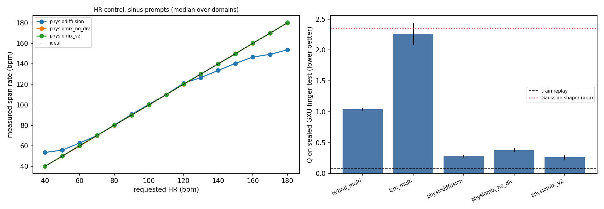
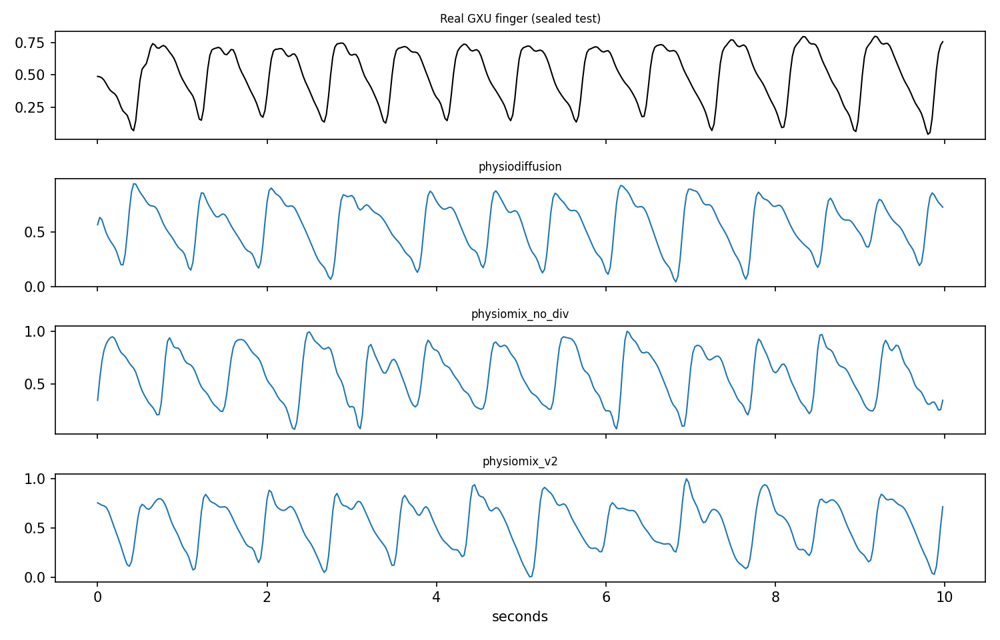

# PhysioMix v2: kết quả benchmark và mô hình đóng gói vào app

Ngày 2026-10-10. Kaggle: `charlesday2612/ppg-physiomix3-data-v1` → `ppg-physiomix3-pilot-v1` → `ppg-physiomix3-benchmark-v1` (2× T4).
Dữ liệu v3 SHA-256 `5036fb64…6433`, tiêu chí khoá trước SHA-256 trong `FROZEN_CRITERION.json`.

## Kiến trúc (PhysioMix v2 = `P4_v2_osc_dc`)

- **Đầu vào**: nhiễu z[1200] + điều kiện 11 chiều = one-hot 6 miền dữ liệu, 2 cờ "nhãn đã biết",
  nhịp tim (bpm), độ bất thường IBI (CV, 0–0.35), biên độ chuẩn hoá.
- **Generator PhysioMixH** (161 726 tham số): chuỗi nhịp dựng từ IBI log-normal (nhịp được *dựng*, không học, nên
  điều khiển HR 40–180 bpm chính xác) → đầu 6 hài hình thái nội suy theo nút 1 s → phần dư tự do bị chặn
  0.15·tanh → lọc 0.5–8 Hz, chuẩn hoá 0–1. Đầu ra 30 s @ 40 Hz, TorchScript CPU ~10 ms.
- **Critic DerivCritic**: 3 thang, spectral norm, projection theo điều kiện, đầu vào [x, 10Δx, 20Δ²x]
  (đạo hàm làm lộ dạng sóng giả; critic v1 gần như đoán mò). Hinge loss, R1 lười, EMA.
- **Nhãn**: đồng thuận 3 ước lượng (phổ, ACF, khoảng nhịp); có ECG thì lấy nhịp ECG khi PPG đồng ý.
  GXU: lệch PPG–ECG trung vị 0.47 bpm.

## Dữ liệu

6 bộ dữ liệu công khai, 10 miền: train/validation/test chia theo người.

| Vai trò | Bộ dữ liệu |
|---|---|
| Train (6 miền) | BIDMC; MIMIC PERform AF, non-AF, Large; Wrist PPG khi vận động (Jarchi & Casson); **GXU finger** (148 người khỏe, mới) |
| Ngoài (chỉ thăm dò) | CapnoBase; PhysioNet PTT (ngồi/đi/chạy) |

6 073 cửa sổ train, 1 290 validation; GXU test niêm phong 22 người (388 cửa sổ) mở đúng một lần sau khi khoá mô hình.

## Kết quả (3 seed × 10 000 bước, chọn checkpoint bằng validation)

| Mô hình | S_arm val (↓) | GXU test Q (↓) | GXU recall | MAE HR 60–140 | C2ST đạo hàm |
|---|---|---|---|---|---|
| **physiomix_v2** | **0.596 ± 0.026** | **0.261 ± 0.035** | 0.71 | 0.5 bpm | 0.91 |
| physiomix_no_div (v1) | 0.700 ± 0.026 | 0.380 ± 0.031 | 0.38 | 0.4 bpm | 0.96 |
| physiodiffusion | 1.038 ± 0.031 | 0.279 ± 0.018 | 0.87 | 4.3 bpm | 0.995 |
| hybrid_multi (không điều kiện) | — | 1.040 | 0.13 | — | — |
| lsm_multi (không điều kiện) | — | 2.261 | 0.01 | — | — |
| Gaussian shaper hiện tại của app | — | 2.352 | — | — | — |
| Train replay (sàn dữ liệu thật) | — | 0.078 | — | — | — |

- Quy tắc so sánh khoá trước: v2 tốt hơn v1 (chênh S_arm 0.105 > SD gộp 0.026, không kém hơn về S_real).
- GXU theo trạng thái (Q): nghỉ 0.353, sau gắng sức A 0.227, B 0.252 (v1: 0.517 / 0.424 / 0.382).
- Validation theo miền: v2 tốt hơn ở GXU và PERform Large, hơi kém v1 ở BIDMC, nhóm AF và cổ tay.
- Sàn C2ST real-vs-real (sửa lại, chia người tách rời, 8 lần): trung bình 0.48 (0.36–0.69). Bản Kaggle in 0.812
  là do lỗi rò người trong probe; đã sửa ở commit sau. C2ST 0.91 nghĩa là vẫn phân biệt được thật/giả.
- Thay đổi so với kế hoạch: tăng 6 000 → 10 000 bước cho mọi arm sau khi pilot cho thấy validation còn giảm ở
  bước 3 000 (quyết định chỉ dựa vào validation). v2 đạt tốt nhất ở bước 2 000–2 500 rồi xấu dần; v1 vẫn cải thiện tới 10 000.

## Đóng gói vào app

`assets/neural/physiomix_generator.ts` = physiomix_v2 seed 42 (S_arm validation thấp nhất 0.579, bước 2 500), kiểm
TorchScript Kaggle khớp checkpoint rồi trace lại bằng torch cục bộ. HR 40–180 bpm; ngoài 40–135 bpm (dải nhãn train)
app ghi "hình thái là ngoại suy". Smoke GUI (DRY RUN): yêu cầu 72/62/95/120/170 → đo 72/62/94/119/170 bpm, DAC
phát rồi về 0 V.

## Giới hạn

- Đây là độ giống phân bố của PPG đã lọc 0.5–8 Hz và độ chính xác điều khiển nhịp tự nhất quán; không phải SpO2,
  không có cặp IR/RED, không phải kiểm chứng lâm sàng. Chưa đo trên Pi/DAC/OPT101.
- Miền cổ tay: 86% nhãn bị che vì chuyển động lấn át nhịp tim (PPG lệch ECG ~52 bpm); mô hình sinh nhịp rất bất thường.
- C2ST 0.91: một bộ phân loại vẫn nhận ra mẫu giả; còn khoảng cách tới dữ liệu thật (Q 0.26 vs replay 0.08).
