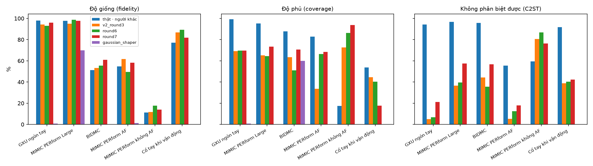
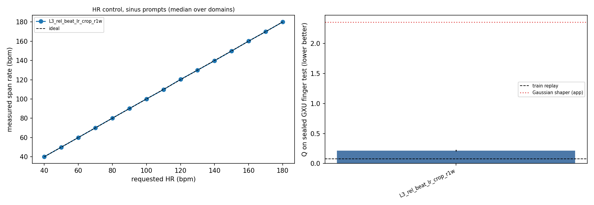
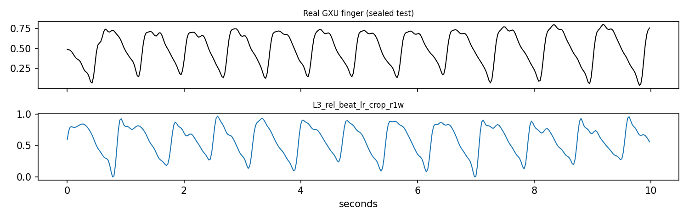
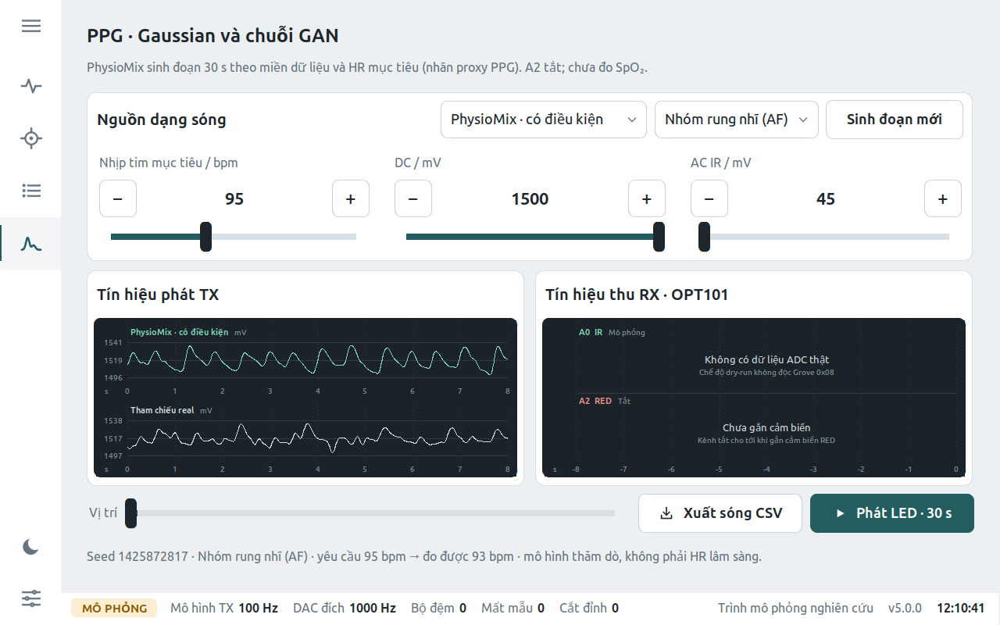

# PhysioMix v3: learning rate, BIDMC/AF, độ giống thật và điều khiển trạng thái

Ngày 2026-10-11. Cùng dữ liệu v3 (SHA-256 `5036fb64…6433`), cùng tiêu chí khoá trước của round 3
(`813c4dd1…`). Mọi lựa chọn chỉ dựa vào validation, theo quy tắc ghi vào file trước khi train
(`rules/`). GXU test đã mở một lần ở round 3, nên ở đây chỉ báo cáo, không dùng để chọn.

## Model đang nằm trong app

Round 7, seed 42 (bước 6 500), commit `258515be`. Giống round 6 nhưng giảm trọng số phạt R1 của critic còn 0,1.
Theo quy tắc khoá trước: S_arm validation 0,510 ± 0,053 so với round 6 0,570 ± 0,023 (chênh 0,059 > SD gộp 0,041),
S_real 0,360 so với 0,357, mọi seed qua mọi cổng. Kiểm tra trên laptop (DRY RUN): pytest 809 passed;
smoke test giao diện PASS (yêu cầu 72/62/95 AF/120/170 bpm, đo ra 71,7/61,7/93,1/118,9/170,4). Chưa đo trên Pi/DAC/OPT101.

## 1. Train lâu hơn với learning rate thấp hơn: không giúp

Round 4: Adam 1e-4 giảm cosine về 1e-5, 20 000 bước (gấp đôi round 3), 4 biến thể × 3 seed (2× T4, 3,3 giờ).
Checkpoint tốt nhất theo validation luôn ở bước 3 500–7 000. Sau đó độ đa dạng giảm (rho 0,97 → 0,86) và
critic lấn át (số lần cắt gradient tăng). Chỉ đổi learning rate (L1) còn kém hơn round 3: S_arm 0,637 so với 0,596.
Dừng sớm theo validation, như pipeline đang làm, là cách đúng.

Nguyên nhân v2 xấu đi khi train lâu (đo trên checkpoint bước 10 000): đầu ra chuẩn hoá min–max nên biên độ
hài được tự do. GAN thu nhỏ hài cơ bản từ 0,3–0,5 xuống 0,03–0,1 cho tới khi phần dư tự do (chặn 0,15) lấn át nhịp
dựng sẵn. Kết quả: yêu cầu 150 bpm đo ra 128–136 bpm.

## 2. Các thay đổi đã thử (mỗi thay đổi có test hồi quy)

| Thay đổi | Vấn đề đo được | Kết quả |
|---|---|---|
| Neo biên độ xung (L2) | Biên độ hài sụp, nhịp trôi ở HR ngoại suy | MAE HR >135 bpm 1,2 → 0,3 |
| Nhịp sinh lý (L3): tâm thu giữ cố định, tâm trương co giãn; biên độ theo khoảng nhịp trước | Độ bất thường bị co 20% (σ=0,2 đo ra 0,16) | σ=0,2 đo ra 0,19; AF Q 0,412 → 0,373 |
| Khớp phân bố riêng từng miền (L4) | Độ phủ BIDMC/AF thấp | Không tốt hơn L3 (BIDMC Q 0,718) |
| Sinh dài 6 s mỗi bên rồi cắt (round 5) | Lọc FFT vòng làm lộ mẫu giả: cửa sổ thật qua cùng bộ lọc cũng bị nhận ra với AUC 0,98 | C2ST đạo hàm 0,91 → 0,78; S_arm 0,527 |
| Ngưỡng cắt gradient ở bước R1 nhân 16 (round 6) | Round 5 trượt cổng `d_clipped`: mọi bước lazy-R1 bị cắt (chuẩn ~100 > 10) | Qua mọi cổng; S_arm 0,570 |
| Trọng số R1 0,1 (round 7) | Round 6 phạt R1 mạnh gấp ~10 lần mức hiệu dụng ở round 5 (vốn luôn bị cắt về 10/~100) | C2ST đạo hàm 0,90 → 0,75; S_arm 0,510 |

| Round · biến thể | S_arm val (↓) | S_real | C2ST đạo hàm | Q BIDMC | Q AF+nonAF | Q cổ tay | GXU test Q* |
|---|---|---|---|---|---|---|---|
| R3 · physiomix_v2 | 0,596 ± 0,026 | 0,366 | 0,911 | 0,639 | 0,412 | 0,528 | 0,261 |
| R4 · L1 chỉ đổi LR | 0,637 ± 0,026 | 0,385 | 0,925 | 0,693 | 0,418 | 0,602 | 0,305 |
| R4 · L2 neo biên độ | 0,652 ± 0,030 | 0,408 | 0,944 | 0,740 | 0,459 | 0,711 | 0,223 |
| R4 · L3 + nhịp sinh lý | 0,588 ± 0,029 | 0,367 | 0,906 | 0,616 | 0,373 | 0,680 | 0,228 |
| R4 · L4 + phân bố từng miền | 0,606 ± 0,020 | 0,378 | 0,928 | 0,718 | 0,426 | 0,666 | 0,211 |
| R5 · L3 + cắt cửa sổ (trượt cổng) | 0,527 ± 0,022 | 0,368 | 0,782 | 0,613 | 0,399 | 0,637 | 0,222 |
| R6 · R5 + sửa ngưỡng R1 | 0,570 ± 0,023 | 0,357 | 0,896 | 0,618 | 0,333 | 0,677 | 0,231 |
| **R7 · R6 + trọng số R1 0,1 (app hiện tại)** | **0,510 ± 0,053** | 0,360 | 0,753 | 0,616 | 0,373 | 0,653 | 0,215 |

\* GXU test đã mở ở round 3; chỉ báo cáo. Q thấp hơn là giống thật hơn; train replay (dữ liệu thật) đạt 0,078.

## 3. BIDMC và AF: giới hạn nằm ở dữ liệu

Dữ liệu thật của người khác (train) so với người validation cùng bộ đạt Q 0,51 ở BIDMC và 0,38 ở nhóm AF/non-AF.
Lý do: chỉ có 46 người BIDMC và 16 + 13 người AF/non-AF, nên khác biệt giữa người lớn hơn khác biệt
model–thật. Riêng thành phần ACF của BIDMC là 0,21 ở mọi model và ở cả dữ liệu thật, do phân bố nhịp của
người train khác người validation. AF cải thiện nhờ nhịp sinh lý: độ phủ người chưa dùng 34% → 66% (round 6), độ bất
thường 0,184 → 0,200 (thật 0,235). Round 6 làm BIDMC trên người chưa dùng kém đi (độ phủ 64% → 51%); round 7 kéo lại 71%, độ giống 61%
(dữ liệu thật của người khác: 51%), không phân biệt được 36% → 57%. AF round 7: độ phủ 68%, không phân biệt được 18%.

## 4. Giống người thật đến đâu, trên từng tập dữ liệu

Chi tiết ở [REALISM_VI.md](REALISM_VI.md). Ba chỉ số trên người chưa từng dùng để train (validation + test):
- **độ giống**: % mẫu sinh nằm trong vùng dữ liệu thật;
- **độ phủ**: % dữ liệu thật mà model sinh được mẫu tương tự;
- **không phân biệt được**: một mạng CNN huấn luyện riêng để tách thật/giả (chia theo người, lặp 3 lần) thất bại
  bao nhiêu; 100% nghĩa là đoán mò.
Mỗi chỉ số đặt cạnh dữ liệu thật của người khác, tức mức trần thực tế.

Không có một con số "% giống thật" duy nhất. Model trong app (round 7), theo thứ tự độ giống · độ phủ · không phân biệt được:

| Tập dữ liệu | Round 7 (app) | Round 6 | Dữ liệu thật người khác (trần) |
|---|---|---|---|
| GXU ngón tay, 44 người | 96% · 70% · 21% | 93% · 70% · 7% | 98% · 99% · 94% |
| PERform Large (ICU), 191 người | 98% · 73% · 57% | 99% · 64% · 39% | 98% · 95% · 97% |
| BIDMC (ICU), 14 người | 61% · 71% · 57% | 55% · 51% · 36% | 51% · 88% · 96% |
| PERform AF, 4 người | 58% · 68% · 18% | 50% · 66% · 12% | 55% · 83% · 56% |
| Cổ tay khi vận động, 4 người | 82% · 18% · 42% | 89% · 40% · 40% | 77% · 54% · 92% |

Round 7 tốt hơn ở GXU, PERform Large, BIDMC và AF. Cổ tay kém đi: độ phủ 40% → 18%, tức model sinh vận động theo
ít kiểu hơn dữ liệu thật. Bộ không AF chỉ có 2 người nên không đủ tin cậy để so. Bộ tạo Gaussian cũ của app: 0% không
phân biệt được ở mọi tập.
Dấu hiệu còn lại ở GXU (đo trên round 6): kết cấu "gợn" nhỏ. Mẫu sinh có 152 cực trị mỗi cửa sổ so với 138 ở dữ liệu thật,
độ cong |Δ²| trung vị 0,0146 so với 0,0117.

## 5. Vận động hay nghỉ? Model có sinh ngẫu nhiên không?

Không ngẫu nhiên. Trạng thái do người dùng chọn qua miền dữ liệu trên trang Neural, ví dụ "Cổ tay · vận động"
(PPG cổ tay khi đi bộ/chạy/đạp xe) hay "Ngón tay" GXU khi nghỉ/sau gắng sức; cùng với HR và độ bất thường.
Kiểm chứng bằng một CNN chỉ học trên dữ liệu thật để gọi tên 7 trạng thái (đoán mò 14%):

| | Dữ liệu thật (người chưa dùng) | v2 | Round 6 | Round 7 (app) | Gaussian cũ |
|---|---|---|---|---|---|
| Lệnh "cổ tay vận động" được nhận đúng | 86% | 91% | 91% | 100% | 8% |
| P(vận động) khi lệnh là trạng thái nghỉ | ≤ 4% | ≤ 8% | ≤ 6% | < 1% | ≤ 2% |
| Trung bình 7 trạng thái | 51% | 52% | 54% | 56% | 20% |
| Cùng nhiễu, chỉ đổi lệnh: đầu ra theo lệnh | — | 48% | 53% | 55% | 17% |

Nếu model bỏ qua lệnh thì mỗi nhiễu chỉ cho một câu trả lời; thực tế mỗi nhiễu cho trung bình 5,2/7 câu
trả lời khác nhau (round 7). Nhiễu z chỉ tạo khác biệt giữa các lần sinh (người khác nhau, nhịp khác nhau).

Giới hạn quan trọng:
- Không có núm "mức vận động" riêng: vận động gắn với bộ cổ tay khi tập, nên khác biệt còn gồm vị trí cảm
  biến (cổ tay vs ngón tay).
- PPG cổ tay thật khi tập khá tuần hoàn (ACF 0,62) theo nhịp bước chân/đạp, không theo nhịp tim. Model sinh
  phần chuyển động như nhiễu hỗn loạn (ACF 0,27 ở round 7), và theo ít kiểu hơn (độ phủ 18%).
- "Sau gắng sức" của GXU là ngồi nghỉ sau tập, không phải đang chuyển động.

## 6. Giới hạn và hướng tiếp

- Đây là độ giống phân bố của PPG đã lọc 0,5–8 Hz và độ chính xác điều khiển nhịp; không phải SpO2,
  không có cặp IR/RED, không phải kiểm chứng lâm sàng. Chưa đo trên Pi/DAC/OPT101.
- Validation đã được dùng qua nhiều round, nên điểm validation hơi lạc quan. GXU test (dùng lại) và đánh giá
  trên người validation + test cho cùng xu hướng.
- Tiếp theo:
  1. Núm vận động thật: bộ dao động thứ hai theo nhịp bước/đạp, học từ dữ liệu có gia tốc kế
     (PPG-DaLiA hoặc kênh IMU của PTT/cổ tay).
  2. Giảm "gợn" nhỏ ở GXU: làm mượt hoặc thu hẹp phần dư.
  3. Thêm người BIDMC/AF.
  4. Đo trên phần cứng.

