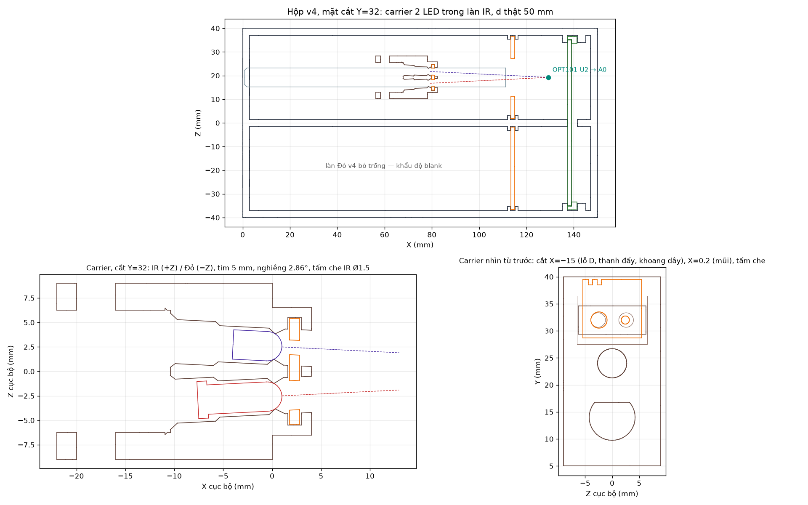
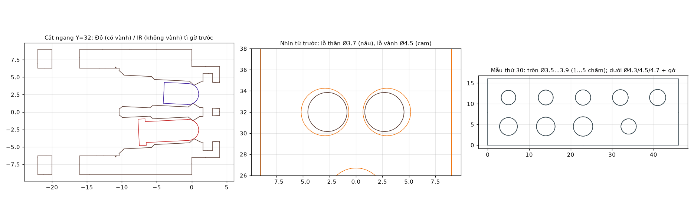

# Chế độ TDM — carrier 2 LED trong hộp chữ nhật v4

Dùng với chế độ RX **TDM**: *Thiết lập → Cảm biến RX → 1 × OPT101 (TDM)*, hoặc
`main.py --rx-mode tdm`. Firmware bật luân phiên RED / IR / DARK, nên LED Đỏ và
LED IR nằm chung **một carrier** trong **một làn** và chiếu vào **một** OPT101.

Nguồn tham số: [build_tdm_chamber.py](build_tdm_chamber.py). Script dùng chung
tham số với [build_system.py](build_system.py) của hộp v4.
**Không thiết kế lại PCB, không in lại thân hộp.**



## Bố trí

- **Hộp:** dùng nguyên thân và nắp chữ nhật v4. Làn IR (Z = +19,25) đồng trục
  với socket **U2 (IR → A0)** của board thu 70 × 20 mm, nên OPT101 duy nhất cắm
  vào U2. Làn Đỏ bỏ trống và cắm tấm khẩu độ `blank`. Hộp một làn riêng sẽ không
  gọn hơn đáng kể, vì đầu cảm biến vẫn phải rộng 80 mm để chứa board thu 70 mm.
- **Carrier 2 LED:** giữ nguyên thân 22 × 35 × 18 mm, lỗ D, lỗ thanh đẩy Ø5,
  vít chặn M3 và hốc dây hông của carrier v4. Vì vậy carrier này trượt trên ray
  D v4 và dùng thanh đẩy, núm, chụp v4 như cũ.
  - Hai LED 3 mm đặt cạnh nhau theo phương ngang (Z): **IR ở phía +Z, Đỏ ở phía −Z**,
    tim cách nhau 5 mm.
  - Mỗi lỗ nghiêng vào trong **2,86°**, để hai trục quang cắt nhau tại cửa sổ
    OPT101 khi d thật = 50 mm.
  - Bốn chân LED đi chung một khoang phía sau, ra hốc dây hông như v4.
  - Lỗ LED được thiết kế theo datasheet của chính LED trong repo. Chi tiết ở mục dưới.
- **Lệch trục:** góc giữa trục LED và đường nối tới tâm cảm biến là 3,0° ở
  d thật 24,2 mm, 0° ở 50 mm và 1,4° ở 99,2 mm. Hai LED lệch bằng nhau.
- **Tấm che (mặt nạ):** cắm từ trên xuống vào khe ở mũi carrier. Lỗ Đỏ luôn Ø3.
  Lỗ IR có bốn cỡ: Ø3 (`mo`), Ø2, Ø1,5, Ø1. Thứ tự biến thể bằng số khía trên tai
  cầm: 0, 1, 2, 3.

## Lỗ LED: kích thước theo datasheet



| | LED Đỏ YSL‑R341R3D‑D2 ([DS](../ds_linhkien/red_led_3.3mm_datasheet.pdf) tr. 2) | LED IR Everlight SIR234 ([DS](../ds_linhkien/IR_led_3.3mm_datasheet.pdf) tr. 5) |
|---|---|---|
| Thân | Ø3,00, dung sai ±0,2 | Ø3,0 ±0,2 |
| Vành | dày 1,0. Đường kính không ghi; hình vẽ ≈ Ø3,4 có mặt vát. CAD lấy bao Ø4,0 | **không có vành** |
| Đỉnh → đáy | 8,6 (thân 7,6 + vành 1,0) | 5,0 ±0,3 |

Carrier v4 cũ có lỗ thân Ø3,3, lỗ vành Ø4,1 và một bậc dừng
đặt sau vành. So với datasheet, thiết kế đó có ba vấn đề:

1. **Khe hở chỉ 0,05 mm mỗi bên** so với LED lớn nhất (Ø3,2). Lỗ in ra luôn hụt
   so với CAD, nên LED không vào được.
2. **LED IR SIR234 không có vành**, nên bậc dừng sau vành không chặn được nó.
3. **LED Đỏ chỉ dài 7,6 mm tính từ vành**, trong khi mô hình cũ giả định 10,4 mm.
   Chóp sẽ chìm khoảng 2,8 mm trong lỗ.

### Thiết kế theo sai số Bambu Lab A1

**Bambu không công bố sai số kích thước cho A1.** Trang thông số kỹ thuật chỉ ghi
đầu phun 0,4 mm, không có con số độ chính xác. Thiết kế dựa trên các nguồn sau:

- [Wiki Bambu về bù lỗ XY](https://wiki.bambulab.com/en/software/bambu-studio/xy-hole-contour-compensation):
  - Với bù lỗ = 0, lỗ M6 phải nới +0,15 mm mỗi bên mới vừa khít ốc, tức lỗ đứng
    hụt khoảng 0,3 mm đường kính.
  - Bù lỗ XY chỉ áp dụng cho **đường kín trong từng lớp**, tức lỗ có trục đứng.
    Lỗ nằm ngang, như carrier trước đây, không được bù và còn bị bậc thang 0,2 mm.
- [Diễn đàn Bambu, A1](https://forum.bambulab.com/t/problem-with-dimensional-accuracy-on-the-a1/96198):
  chi tiết 15–20 mm hụt 0,2–0,25 mm, sai số X và Y khác nhau, và một khe 4 mm
  in ra chỉ còn 3,5 mm.

Từ đó, script dùng hai mức giả định cho lỗ đứng Ø3–5 mm: hụt **0,2 mm** (thường
gặp) và hụt **0,4 mm** (xấu nhất, dùng để kiểm tra). Mẫu thử 30 sẽ cho con số
thật của máy bạn.

Thay đổi so với bản trước:

- **In dựng đứng, mặt sau áp bàn** (26 mm cao, mặt bám bàn 451 mm²). Hai lỗ LED,
  lỗ D và lỗ thanh đẩy đều thành lỗ đứng: tròn, không bậc thang, không võng trần,
  và bù lỗ XY có tác dụng nếu cần. Lỗ hình giọt nước không còn cần nữa.
- **Lỗ thân Ø3,7, lỗ vành Ø4,5** (bản trước Ø3,6 / Ø4,4):
  - Hụt 0,2 mm: khe hở còn 0,15 mm mỗi bên với LED lớn nhất, 0,25 mm mỗi bên với
    LED danh định Ø3,0.
  - Hụt 0,4 mm: LED lớn nhất vẫn luồn được.
- **Không còn gờ phẳng treo trong lỗ.** Khi in dựng đứng, LED đi từ dưới lên.
  Mọi chỗ lỗ thu hẹp (bậc vành → thân, mép gờ chặn Ø2,6, miệng lỗ ở trần khoang
  chân) là côn 40°. Cộng với độ nghiêng 2,86° của trục LED, mặt treo dốc nhất là
  42,8°, dưới ngưỡng 45° mà máy in tự đỡ được, nên không cần support.
- **Vát 45° × 0,5 mm ở miệng lỗ D và lỗ thanh đẩy trên mặt áp bàn**, để lớp đầu
  bị ép loe (chân voi) không bóp nhỏ miệng lỗ. Miệng hai lỗ LED nằm ở trần khoang
  chân và có phễu dẫn hướng.
- **Khe tấm che 1,4 mm** (bản trước 1,3 mm). Trần khe là một cầu in nên sẽ võng
  xuống một chút. Đáy và trần khe rơi đúng bội lớp 0,2 mm.
- Gờ chặn ở phía trước giữ nguyên nguyên lý: đẩy LED tới khi chóp cầu tì mép
  Ø2,6. Cả hai LED dừng cùng một chỗ, có vành hay không cũng vậy.
- Vách nhựa giữa hai lỗ: 1,19 mm ở đoạn Ø4,5, 1,0 mm ở đoạn Ø3,7.

**Cài đặt in (Bambu Studio, A1):**

- Hồ sơ 0,20 mm Standard, đầu phun 0,4, PLA.
- Bù lỗ XY = 0 và bù viền XY = 0. Kích thước lỗ đã tính sẵn độ hụt; mẫu thử dùng
  để chỉnh.
- Không support, không brim.
- Mẫu thử và carrier **phải in cùng hồ sơ, cùng cuộn nhựa**, vì độ hụt phụ thuộc
  vật liệu.
- Mối nối (seam) có thể để lại một gờ nhỏ trong lỗ. Nếu LED vướng, xoay nhẹ một
  mũi khoan Ø3,5 bằng tay trong lỗ.

**In mẫu thử trước khi in carrier:** `30_mau_thu_lo_LED.stl` là tấm 46 × 16 × 6 mm,
in cùng tư thế (lỗ đứng, miệng dưới vát) và mất vài phút. Các lỗ:

- Hàng trên: lỗ thân Ø3,5 / 3,6 / **3,7** / 3,8 / 3,9, đánh dấu bằng 1…5 chấm
  trên mặt trên. Ba chấm là cỡ đang dùng.
- Hàng dưới: lỗ vành Ø4,3 / **4,5** / 4,7 (1…3 chấm), và một lỗ Ø3,7 có côn và
  gờ chặn Ø2,6 ở mặt trên.

Luồn LED **từ mặt dưới** (mặt áp bàn), giống chiều luồn vào carrier:

1. Chọn lỗ **nhỏ nhất** mà LED trượt vào bằng tay, không cần ấn. Thử cả hai LED
   ở lỗ thân; lỗ vành chỉ thử với LED Đỏ.
2. Thử lỗ có gờ: chóp phải dừng lại và nhô lên mặt trên.
3. Dựng lại carrier với cỡ đã chọn, ví dụ:

```bash
.cad_venv/bin/python docs/system_3d/build_tdm_chamber.py --bore-d 3.6 --flange-bore-d 4.5
```

Script chạy lại toàn bộ kiểm tra. Nếu bạn chọn cỡ nhỏ hơn mặc định, các kiểm tra
dựa trên giả định hụt 0,4 mm có thể báo FAIL. Trường hợp đó kết quả trên mẫu thử
thật được ưu tiên hơn giả định; STL vẫn được xuất. Nếu có thước cặp, gửi tôi số
đo thân và vành LED thật cùng đường kính lỗ in ra; tôi sẽ thay giả định bằng số đo.

**Giữ LED cố định:** lỗ có khe hở nên LED không bị ép chặt. Đẩy LED tới khi chóp
tì gờ, bẻ chân vào hốc dây hai bên hông, rồi cố định phía sau bằng một chấm keo
nến hoặc băng Kapton. Không ép keo vào lỗ phía trước.

**Lỗ D và lỗ thanh đẩy** giữ khe hở như carrier v4 (0,25 mm và 0,20 mm mỗi bên),
nhưng giờ là lỗ đứng. Nếu A1 hụt 0,4 mm thì khe hở còn 0,05 mm và carrier có thể
trượt nặng trên ray D. Khi đó, xoay tay một mũi khoan Ø8,5 trong lỗ D. Tôi chưa
kiểm tra độ trượt trên bản in thật.

## Vì sao cần tấm che

Hai LED giờ nằm ở **cùng khoảng cách d**, nên không chỉnh d riêng cho từng LED
được nữa. Theo bảng ước lượng kế thừa trong README v4 (chưa đo), LED IR có thể
sáng hơn LED Đỏ hàng chục lần ở cùng d. Có ba cách cân lại, nên thử theo thứ tự:

1. **Mức DAC:** đặt DC và AC riêng cho IR và RED trên giao diện. Cách này không
   cần phần cứng mới, nhưng IR ở mức thấp sẽ mất độ phân giải (MCP4725 ≈ 0,8 mV mỗi bước).
2. **Tấm che IR** (Ø2 / Ø1,5 / Ø1): giảm ánh sáng IR đi vào làn. Lỗ nằm sát chóp
   LED, nên mức giảm phụ thuộc giản đồ phát của LED thật. **Phải đo; không suy ra
   từ tỉ lệ diện tích lỗ.**
3. **Điện trở R_sense của kênh IR** trên board driver: đổi giá trị linh kiện,
   không sửa PCB. Xem [COMPONENT_RATIONALE.md](../../hardware/led_ir_driver/COMPONENT_RATIONALE.md)
   và kiểm tra lại dòng, công suất trước khi đổi.

## File in (bàn 180 mm, đơn vị mm, tỷ lệ 100 %)

**In mới:** [out/tdm/print_bambu_180/](out/tdm/print_bambu_180/)

| File | SL | Kích thước in X × Y × Z (mm) |
|---|---:|---|
| `25_carrier_2LED_TDM.stl` | 1 | 18 × 35 × 26 — **dựng đứng, mặt sau áp bàn** |
| `26_tam_che_mo.stl` | 1 | 10,8 × 10,8 × 1 — Đỏ Ø3, IR Ø3 |
| `27_tam_che_ir2.stl` | 1 | IR Ø2 |
| `28_tam_che_ir1_5.stl` | 1 | IR Ø1,5 |
| `29_tam_che_ir1.stl` | 1 | IR Ø1 |
| `30_mau_thu_lo_LED.stl` | 1 | 46 × 16 × 6 — **in trước** để chọn cỡ lỗ |

**Dùng lại** từ [out/print_bambu_180/](out/print_bambu_180/):

| File | SL | Vai trò |
|---|---:|---|
| `01_than_hop_toi.stl`, `02_nap_labyrinth.stl` | 1 + 1 | thân và nắp chữ nhật v4 |
| `03_truc_truot_D.stl` | 1 | ray D của làn IR |
| `12_truc_day_tron_D5x130.stl`, `05_num_thanh_truot.stl` | 1 + 1 | thanh đẩy và núm làn IR |
| `08_khau_do_biet.stl` | 1 | bịt làn Đỏ đang bỏ trống |
| `11_khau_do_lo16mm.stl` hoặc `10_khau_do_lo5mm.stl` | 1 | khẩu độ làn IR. **Không dùng Ø2**: lỗ này chắn một phần tia lệch tâm |
| `06_chup_luon_day_trai.stl`, `07_chup_luon_day_phai.stl` | 2 + 2 | chụp đủ bốn cửa cáp để hộp kín sáng |
| `14_ga_chu_U_OPT101_70x20.stl` | 1 | gá H của board thu |

Carrier v4, ray, thanh đẩy và núm của làn Đỏ không cần dùng.
[manifest.json](out/tdm/print_bambu_180/manifest.json) ghi kích thước, SHA-256
và góc lệch trục. `out/tdm/stl/` là hệ lắp ráp, chỉ để kiểm tra.

## Lắp

1. **Board thu:** chỉ cắm OPT101 vào socket **U2**, nối J2 vào A0. Để trống U1.
   Lắp gá H như hộp v4.
2. **LED:** luồn từ mặt sau carrier, đẩy tới khi chóp tì gờ trước. IR vào lỗ
   phía +Z (phía xa vách ngăn giữa), Đỏ vào lỗ phía −Z. Bẻ chân, cố định phía sau
   như hướng dẫn ở mục *Lỗ LED*.
3. Luồn carrier lên ray D của **làn IR**, rồi lắp thanh đẩy, vít chặn và núm như v4.
4. Cắm tấm che: bắt đầu với `mo`. Nếu kênh IR chạm trần ADC hoặc trần OPT101,
   đổi sang tấm che lỗ IR nhỏ hơn.
5. Làn IR cắm khẩu độ Ø16 hoặc Ø5; làn Đỏ cắm `blank`. Hạ nắp, lắp bốn chụp cáp.
6. **Đọc d:** giống v4, khe thanh trần (giữa bệ và núm) = d_v4 − 6 mm.
   Với board thu 70 × 20 mm, d thật = d_v4 + 9,2 mm. Con số 9,2 mm suy ra từ giả
   định khoảng cách mặt PCB → cửa sổ OPT101 là 8,3 mm. Nếu đo được h thật thì
   d thật = d_v4 + 17,5 − h.

## Đã kiểm tra (hình học CAD danh nghĩa)

Chạy `build_tdm_chamber.py`: **47/47 PASS**, xem
[out/tdm/fit_report.json](out/tdm/fit_report.json). Ngưỡng giao nhau 10⁻⁴ mm³,
riêng các phép quét LED dùng 10⁻³ mm³ vì mặt cầu được chia lưới.

**Lỗ LED và khả năng in trên A1**

- Khe hở bán kính sau in, với giả định hụt 0,2 mm: 0,15 mm cho thân Ø3,2 và vành
  Ø4,0. Vách giữa hai lỗ ≥ 0,8 mm.
- Phép quét luồn LED từ ngoài mặt sau tới gờ chặn, bước 0,25 mm dọc trục nghiêng,
  cho mỗi LED (Đỏ có vành, IR không vành) ở cả cỡ danh định và cỡ lớn nhất theo
  dung sai: không cấn ở bất kỳ vị trí nào.
- Giả định lỗ hụt 0,4 mm (xấu nhất): LED lớn nhất vẫn luồn được. Giả định hụt
  0,2 mm: LED danh định lỏng 0,25 mm mỗi bên, trong giới hạn 0,3 mm.
- Gờ chặn được LED: đẩy thêm 0,15 mm thì chạm. Chóp LED danh định và LED lớn
  nhất chênh nhau dưới 0,1 mm.
- Tư thế in dựng đứng:
  - Mặt treo dốc nhất trong vùng lỗ LED là 42,8°, dưới ngưỡng 45°.
  - Đáy và trần khe tấm che, mặt trước carrier và mũi đều rơi đúng bội lớp 0,2 mm.
  - Cao 26 mm, mặt bám bàn 451 mm².
- **Kiểm tra ngược:** cùng bộ kiểm tra báo lỗi đúng chỗ khi đổi thiết kế xấu đi:
  - Gờ phẳng (côn 89°): báo mặt treo 90°.
  - Lỗ Ø3,6 / Ø4,4 của bản trước: hai kiểm tra luồn LED khi lỗ hụt 0,4 mm báo lỗi.
  - Lỗ Ø3,3 / Ø4,1 của carrier cũ: 4 kiểm tra báo lỗi.

**Tấm che, hành trình và đường nhìn**

- Carrier, bốn tấm che và mẫu thử đều kín (watertight) và là một khối liền.
- Tấm che trượt vào khe, không chạm chóp LED.
- Quét d v4 từ 15 đến 90 mm: carrier, thanh đẩy, núm và tấm che không chạm
  thân, nắp, ray hay khẩu độ v4 nào. Ở d nhỏ nhất, carrier không chạm gá H, PCB
  hay socket.
- Đường nhìn ở d thật 24,2 / 50 / 99,2 mm, qua khẩu độ Ø16 và Ø5: tia từ hai chóp
  LED tới tâm và bốn góc vùng nhạy không bị chắn, với cửa sổ cảm biến ở
  X = 126,5…132. Với mọi tấm che, tia chính tới tâm OPT101 thông suốt.
- Khẩu độ Ø2 chắn một phần tia; khẩu độ `blank` chắn hết.

## Chưa kiểm tra

- **Độ hụt lỗ thật trên A1 của bạn.** Các mức 0,2 mm và 0,4 mm là giả định lấy
  từ wiki và diễn đàn Bambu; mẫu thử 30 dùng để đo. Bambu không công bố sai số cho A1.
- Độ trượt của carrier trên ray D khi lỗ D in dựng đứng.
- Đường kính vành LED Đỏ: datasheet không ghi, CAD lấy bao Ø4,0.
- Chưa in thử carrier. Khe tấm che rộng 1,4 mm và có trần là cầu in; phần nhựa
  trước khe 1,0 mm, hai bên khe 1 mm. Cần kiểm tra độ võng và độ cứng trên bản in thật.
- Chưa đo giản đồ phát LED, mức giảm sáng của tấm che, rò sáng hay mức tín hiệu
  OPT101. Chưa đo chiều cao h thật của OPT101 trong socket.

## Tái sinh

```bash
.cad_venv/bin/python docs/system_3d/build_tdm_chamber.py
```

Tham số dòng lệnh: `--bore-d`, `--flange-bore-d`. Tham số trong file:
`LED_PITCH`, `D_CONV_REAL`, `LIP_D`, `MASK_KINDS`, `SOCKET_H`,
`A1_HOLE_SHRINK_NOM`, `A1_HOLE_SHRINK_MAX`, `CONE_DEG`, `LEAD_IN`.
Script trả mã thoát 1 nếu có kiểm tra không đạt.
